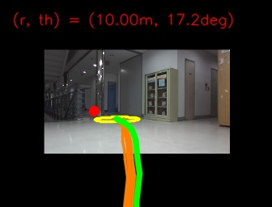
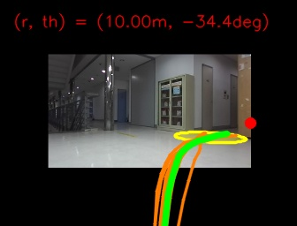

<h1 align="center">CanonNav: Disentangling Navigation Behavior from Camera Geometry in Cross-Platform Visual Navigation</h1>

<p align="center">
  Dong-Wook Kim, Ji-Hoon Hwang, E-In Son, Mintaek Oh, Seung-Woo Seo
  <br>
  Seoul National University, Republic of Korea
</p>

<p align="center">
  <a href="https://arxiv.org/abs/2608.30242">Paper</a> ·
  <a href="https://dongwookkim110.github.io/canonnav-project/">Project Page</a>
</p>

Official implementation of **CanonNav: Disentangling Navigation Behavior from Camera Geometry in Cross-Platform Visual Navigation**. CanonNav learns robust RGB-only navigation from cross-platform demonstrations by disentangling navigation behavior from camera geometry and incorporating complementary planning supervision in a canonical space.

- [Installation](#installation)
- [Inference Demo](#inference-demo)
  - [1. Prepare the weights](#1-prepare-the-weights)
  - [2. Single-image inference](#2-single-image-inference)
  - [3. ROS1 Gazebo example (AWS RoboMaker Hospital)](#3-ros1-gazebo-example-aws-robomaker-hospital)
- [Training](#training)
- [Citation](#citation)
- [License](#license)
- [Acknowledgement](#acknowledgement)

## Installation

Tested on Ubuntu 20.04, Python 3.10, PyTorch 2.4.1 (CUDA 11.8).

```bash
git clone https://github.com/DongwookKim110/CanonNav.git
cd CanonNav

conda create -n canonnav python=3.10 -y
conda activate canonnav
pip install torch==2.4.1 torchvision==0.19.1 --index-url https://download.pytorch.org/whl/cu118   # match your CUDA
pip install -e .
```

CanonNav uses DINOv3 (ViT-S+) as its backbone. Clone [facebookresearch/dinov3](https://github.com/facebookresearch/dinov3)
and download `dinov3_vits16plus_pretrain_lvd1689m-4057cbaa.pth` following its instructions; their paths are set in
[Prepare the weights](#1-prepare-the-weights).

## Inference Demo

### 1. Prepare the weights

- **CanonNav checkpoint:** download `canonnav.pt` from the [release page](https://github.com/DongwookKim110/CanonNav/releases/tag/v1.0) into `checkpoints/`:
  ```bash
  wget -P checkpoints https://github.com/DongwookKim110/CanonNav/releases/download/v1.0/canonnav.pt
  ```
- **DINOv3:** set the paths of the DINOv3 clone and its weight file (see [Installation](#installation)) in
  `configs/canonnav.yaml`:
  ```yaml
  network:
    dino:
      repo_dir: /path/to/dinov3
      pth: /path/to/dinov3_vits16plus_pretrain_lvd1689m-4057cbaa.pth
  ```

---

### 2. Single-image inference

```bash
# goal-directed: goal 10 m away, 0.3 rad to the left
python scripts/demo_image.py \
    --image assets/sample_hallway.jpg \
    --checkpoint checkpoints/canonnav.pt \
    --camera configs/camera/zed.yaml \
    --goal 10.0 0.3 \
    --out outputs/demo_goal.jpg
```

| Argument | Description |
|---|---|
| `--image` | input camera image |
| `--checkpoint` | CanonNav checkpoint (a release checkpoint or a training checkpoint) |
| `--camera` | camera config of the input image (see below) |
| `--goal R THETA` | goal in the robot frame: `R` [m], `THETA` [rad, left +]. Omit for exploration |
| `--out` | output image path (default `outputs/vis.jpg`) |
| `--sample-num` | number of candidate paths (default 30) |
| `--seed` | random seed of the diffusion sampling (default 0) |
| `--device` | e.g. `cuda:0`, `cpu` (default: CUDA if available) |

#### Camera config

Fill in the parameters of the camera that took the input image (e.g. `configs/camera/zed.yaml`):

```yaml
K:                 # 3x3 intrinsic of the input image
  - [491.5841369628906, 0.0, 332.99658203125]
  - [0.0, 491.5841369628906, 195.59390258789062]
  - [0.0, 0.0, 1.0]
size: [376, 672]   # image size [H, W]
height: 0.54       # camera height above the ground [m]
pitch: 0.0         # [deg], + looks up, - looks down
```

#### Example output

The input image warped to the canonical camera, with the SoR (yellow), the best path (green), the other
candidate paths (orange) and the goal (red).

| `--goal 10.0 0.3` | `--goal 10.0 -0.6` |
|---|---|
|  |  |

---

### 3. ROS1 Gazebo example (AWS RoboMaker Hospital)

A Jackal with a forward camera follows a waypoint route in the
[AWS RoboMaker hospital world](https://github.com/aws-robotics/aws-robomaker-hospital-world) (ROS Noetic, Gazebo).
`canonnav_node` predicts the SoR and the best path from the camera image and the next waypoint goal, and
`tracker_node` turns the path into `cmd_vel`.

#### Step 1. Install the simulation environment

```bash
sudo apt install ros-noetic-gazebo-ros-pkgs ros-noetic-jackal-description ros-noetic-jackal-control \
    ros-noetic-robot-localization ros-noetic-twist-mux ros-noetic-compressed-image-transport

# hospital world (archived repository; use the ros1 branch)
git clone -b ros1 https://github.com/aws-robotics/aws-robomaker-hospital-world.git
cd aws-robomaker-hospital-world && ./setup.sh   # downloads the Gazebo Fuel models
```

#### Step 2. Build the CanonNav ROS workspace

```bash
conda activate canonnav
pip install rospkg catkin_pkg empy==3.3.4   # needed only for the ROS example
conda deactivate

cd /path/to/CanonNav/ros
source /opt/ros/noetic/setup.bash
catkin_make -DPYTHON_EXECUTABLE=/path/to/env/bin/python   # the Python where canonnav is installed
```

#### Step 3. Run

Open each terminal *without* the conda env activated (roslaunch and xacro need the system Python), then
`source /opt/ros/noetic/setup.bash && source /path/to/CanonNav/ros/devel/setup.bash`.

```bash
# terminal 1: hospital world + Jackal (spawned at the start of the route)
roslaunch canonnav_hospital_example hospital_world.launch \
    hospital_world_dir:=/path/to/aws-robomaker-hospital-world \
    sim_speed:=2

# terminal 2: CanonNav + tracker
roslaunch canonnav_ros canonnav.launch

# terminal 3: visualization (Image display, topic /canonnav/vis/compressed)
rviz
```

- Routes are in `ros/src/canonnav_hospital_example/waypoints/`. To use another one, pass it to the world launch, e.g.
  `waypoint_file:=$(rospack find canonnav_hospital_example)/waypoints/waypoints9.txt`.
- `sim_speed:=2` (or `3`) runs the simulation 2x (3x) faster than real time if the machine keeps up. 
- If the robot cannot reach a goal (timeout, stuck or tilted), `recovery_node` moves it onto the goal and the run continues with the next one (`recovery:=false` to disable).
- The hospital world is from [aws-robomaker-hospital-world](https://github.com/aws-robotics/aws-robomaker-hospital-world)
  (MIT-0); its Gazebo Fuel models (patients, beds, medical equipment, ...) are by Open Robotics under CC BY 4.0.

#### Example runs

`/canonnav/vis` while driving `waypoints3.txt` and `waypoints9.txt`:

**`waypoints3.txt`**

https://github.com/user-attachments/assets/a710171d-e372-41e3-a8b0-25ce743255be

**`waypoints9.txt`**

https://github.com/user-attachments/assets/2fd92d44-650c-4a2e-abb4-a32245ea0b14

## Training

See [docs/training.md](docs/training.md): dataset layout, label generation, training and checkpoint export.

## Citation

```bibtex
@misc{kim2026canonnav,
      title={CanonNav: Disentangling Navigation Behavior from Camera Geometry in Cross-Platform Visual Navigation},
      author={Dong-Wook Kim and Ji-Hoon Hwang and E-In Son and Mintaek Oh and Seung-Woo Seo},
      year={2026},
      eprint={2608.30242},
      archivePrefix={arXiv},
      primaryClass={cs.RO},
      url={https://arxiv.org/abs/2608.30242},
}
```

## License

The code is released under the MIT License (see [LICENSE](LICENSE)).
The sample dataset is released under [CC BY-NC 4.0](https://creativecommons.org/licenses/by-nc/4.0/).

## Acknowledgement

This code builds on the following projects. We thank the authors for releasing their code.

- [visualnav-transformer](https://github.com/robodhruv/visualnav-transformer) (ViNT / NoMaD)
- [Diffusion Policy](https://github.com/real-stanford/diffusion_policy)
- [DINOv3](https://github.com/facebookresearch/dinov3)
